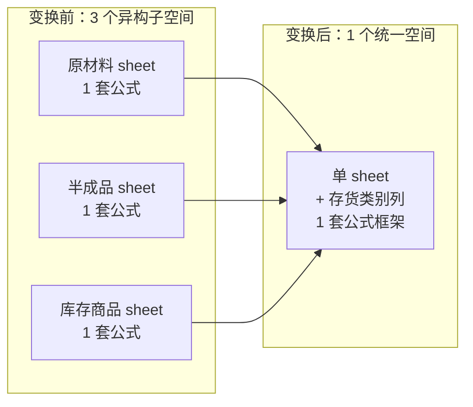
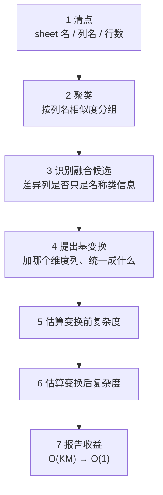
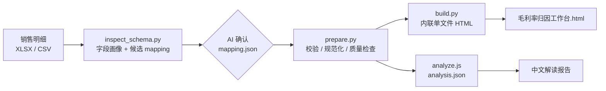

# MySkill

**把审计一线的数据处理经验，沉淀成 AI 能直接执行的方法论 Skill。**

<p>
  
  
  
  
</p>

审计员有 **2/3 的时间花在数据处理上**。这个仓库不做又一个 Excel 插件，而是把「怎么把数据处理变快」这件事本身，写成一套可被 AI 执行的推理流程——AI 读到方法论后，能自己判断该合并哪几张表、公式为什么会重复 75 遍、以及省下来的时间到底省在哪。

---

## 目录

- [为什么需要它](#为什么需要它)
- [核心模型：三个概念讲清审计效率](#核心模型三个概念讲清审计效率)
- [两个 Skill 一览](#两个-skill-一览)
- [快速开始](#快速开始)
- [Skill 1：audit-basis-sense（审计基感知）](#skill-1audit-basis-sense审计基感知)
- [Skill 2：gross-margin-attribution（毛利率归因）](#skill-2gross-margin-attribution毛利率归因)
- [设计原则](#设计原则)
- [环境与依赖](#环境与依赖)
- [常见问题与边界](#常见问题与边界)
- [仓库结构](#仓库结构)
- [License](#license)

---

## 为什么需要它

审计现场最典型的低效不是「算得慢」，而是**同一件事做了 N 遍**：

- 原材料、半成品、库存商品三张计价测试表，列结构一模一样，公式要分别设 3 套；
- 12 个月的费用报告各占一个 sheet，每个月重设一次；
- N 个部门用同一套模板，N 份公式手工维护。

人不是被计算拖住的，是被**重复的界面操作**拖住的。要优化，先得有一套能描述「重复量」的度量方式——这就是下面三个概念的作用。

---

## 核心模型：三个概念讲清审计效率

### 1. 两种原子：A_ui 与 A_cog

审计中的所有操作，最终都拆成两种原子：

| 原子 | 定义 | 例子 | 复杂度 |
| --- | --- | --- | --- |
| **界面交互原子** `A_ui` | 一次鼠标 / 键盘 / API 操作。只要工具支持批量，10 行和 10 万行耗时都是 1 个单位 | 拖填充柄到底、Ctrl+C/V、跑一个脚本 | **O(1)** |
| **认知判断原子** `A_cog` | 一次需要人脑（或 AI）推理的判断。数据每多一行，判断就实打实多一次 | 肉眼核对金额、逐条读摘要判风险 | **O(N)** |

### 2. 审计大 O ≠ 计算机大 O

| 操作 | 计算机大 O | 审计大 O | 为什么 |
| --- | --- | --- | --- |
| VLOOKUP 匹配 5,000 行 | O(N²) | **O(1)** | 人只拖一下填充柄 |
| 肉眼逐行核对 5,000 行 | O(N) | **O(N)** | 每行一次认知判断 |
| 复制粘贴 10 万行 | O(N) | **O(1)** | 人只按一次 Ctrl+V |

> **关键洞察**：审计时间复杂度由**人的原子操作数量**决定，与计算机的算法复杂度无关。

而审计 O 天然**封顶在 O(N) 或 O(KN)**——你不可能对 10 万行做 O(N²) 次人脑判断。所以优化的方向只剩一个：

> **把 `A_cog` 尽可能地转化为 `A_ui`。** 让机器做 N 次批量操作，让人只做 K 次真正的判断（K 是异常行数，通常远小于 N）。

### 3. 基变换：降维 / 融合 → 降熵 → 降复杂度

一个 Excel 工作簿就是一个**向量空间**：

- 每个 **sheet** = 一个向量
- 向量的分量 = `[sheet 名, 列 1, 列 2, …, 列 K]`
- 空间的**维度 / 基** = 列的集合

三张存货 sheet 其实只差第一列名：

```text
原材料计价测试   → [原材料明细表, 期初, 本期增加, 本期发出, 期末余额]
半成品计价测试   → [半成品明细表, 期初, 本期增加, 本期发出, 期末余额]
库存商品计价测试 → [库存商品明细表, 期初, 本期增加, 本期发出, 期末余额]
                                              ↑ 核心金额列完全相同
```

它们没被合并，唯一原因是「类别」这个信息只被编码在 sheet 名里。**补一个「存货类别」列，把它从 sheet 名还原成数据**，三个异构子空间立刻合并成一个统一空间：



信息熵从「3 个独立映射」降到「1 个映射覆盖全部向量」，公式从 N 套坍缩为 1 套，`A_cog: O(N) → O(1)`。

---

## 两个 Skill 一览

| | **audit-basis-sense** | **gross-margin-attribution** |
| --- | --- | --- |
| **一句话** | 诊断 Excel 工作簿结构，给出「合表 + 统一公式」的改造方案 | 把两期销售明细做成可复核的毛利率归因工作台 |
| **解决的问题** | 结构雷同的 sheet 各自为政，公式重复 N 遍 | 毛利率变了多少、谁拉高、谁拉低 |
| **输入** | `.xlsx` 工作簿，或用户口述的表结构 | 两期销售明细（XLSX / XLSM / CSV） |
| **输出** | 结构 JSON + 优化方案（改造步骤 + 复杂度前后对比） | 单文件 HTML 工作台 + `analysis.json` + 中文报告 + 6 位小数 CSV |
| **依赖** | Python 标准库 | Python + openpyxl + Node.js |
| **是否需要 AI** | 需要（方法论由 AI 解读） | 需要（字段确认与报告撰写） |

两个 Skill 的共同点：**脚本只做结构提取和数值计算，判断与解读交给 AI**。这样升级方法论时不用改代码，换数据时也不用改判断逻辑。

---

## 快速开始

### 方式一：作为 Skill 使用（推荐）

把 skill 目录放进 Claude Code 的 skills 目录，AI 会在命中触发词时自动加载：

```bash
# 全局可用
cp -r audit-basis-sense ~/.claude/skills/
cp -r gross-margin-attribution ~/.claude/skills/

# 或仅在当前项目可用
cp -r audit-basis-sense ./project/.claude/skills/
```

然后直接说人话就行：

| 你说 | 触发哪个 Skill |
| --- | --- |
| 「我这 3 个 sheet 列基本一样，公式要设 3 遍，太麻烦」 | audit-basis-sense |
| 「存货底稿有 9 张 sheet，帮我看怎么合并」 | audit-basis-sense |
| 「这是两期销售明细，毛利率跌了，谁拉低的？」 | gross-margin-attribution |
| 「按客户 / 产品 / 地区拆一下毛利率变化」 | gross-margin-attribution |

Skill 的触发词、执行协议、硬规则都写在各自的 `SKILL.md` 里，可以按需改。

### 方式二：只用脚本

不想装 Skill 也可以直接跑命令行。**结构诊断**（纯标准库，零依赖）：

```bash
python audit-basis-sense/scripts/analyze_sheet_structure.py 存货底稿.xlsx > structure.json
```

**毛利率归因**（需要 openpyxl 与 Node.js）：

```bash
export PYTHONIOENCODING=utf-8            # Windows 建议先设
mkdir -p work

# 1. 先看字段，AI/人工确认后再写 mapping
python gross-margin-attribution/scripts/inspect_schema.py 销售明细.xlsx --out work/schema.json

# 2. 一键跑完 prepare → build → analyze
python gross-margin-attribution/scripts/run.py 销售明细.xlsx \
  --mapping work/mapping.json --outdir work
```

产物落在 `work/`：`毛利率归因工作台.html`、`analysis.json`、`data.csv`、`quality.json` 等。

> `inspect_schema.py` 给出的 `suggested_mapping` **只是候选**，不要直接拿来用——必须比对 samples、类型、缺失率和唯一值后手写 `mapping.json`。这是整个流程里最不能省的一步。

---

## Skill 1：audit-basis-sense（审计基感知）

### 它做什么

把一个 Excel 工作簿看成向量空间，找出「只差 1–2 列」的 sheet 组，提出基变换方案，并算出改造前后的审计复杂度。

### 7 步优化协议

`SKILL.md` 里的执行链路，AI 逐步走完才给结论：



聚类的判定门槛：列名**完全匹配**为高度候选；重叠率 **≥ 70%**（公共列数 / 双方列数的较小值）为强候选；**< 70%** 通常不是同一类。但 70% 不是铁律——语义上同属一类底稿时，即使结构差得多也应该提。

### 典型收益

| 场景 | 变换前 | 变换后 | 审计 O |
| --- | --- | --- | --- |
| 3 种存货 × 3 种程序 | 9 张 sheet、75 遍公式 | 3 张 sheet、1 套公式框架 | 公式设置 O(75) → O(1) |
| 12 个月费用报告 | 12 套公式 | 1 套公式 +「月份」列 | O(12) → O(1) |
| N 个部门同模板 | N 套公式 | 1 套公式 +「部门」列 | O(N) → O(1) |

> 注意：省掉的是**公式设置**（`A_ui`），判断计价异常的工作量（`A_cog`）不会消失，只是从「N 行全看」收敛到「K 个异常行」。

### 内置工具

```bash
python audit-basis-sense/scripts/analyze_sheet_structure.py <文件.xlsx>
```

输出结构 JSON，关键字段：

| 字段 | 含义 |
| --- | --- |
| `sheets[].columns` | 列名列表（取第一行非空） |
| `sheets[].row_count` | 估算行数 |
| `analysis_hints.identical_structure_groups` | 预计算的相似 sheet 分组 |
| `…groups[].common_columns` / `differing_columns` | 组内公共列 / 各自独有列 |

脚本**不含任何审计判断**，它只负责把结构摆出来。解读、提方案、算复杂度是 AI 用方法论做的事。

### 参考文档（按需读，不必全读）

| 文件 | 内容 |
| --- | --- |
| `SKILL.md` | 执行入口：理论 + 7 步协议 + Gotchas |
| `references/patterns.md` | 4 类常见底稿模式（程序×类别、同期×期间、模板×实体、大表非基变换） |
| `references/examples.md` | 4 个实战案例的完整推演 |

---

## Skill 2：gross-margin-attribution（毛利率归因）

### 它做什么

输入一份两期销售明细，输出：**毛利率从 x% 变到 y%、变了多少 pp、谁拉高、谁拉低**，且每个结论都能在页面上点回订单级明细复核。

它只做数据归因，**不解释业务原因**——「客户为什么降价」不在它的射程内。

### 工作流



`run.py` 把 prepare → build → analyze 串成一键，支持两个严格开关：

| 开关 | 作用 |
| --- | --- |
| `--strict-dims` | 弱维度（`not_recommended` / `needs_reason`）没写理由就失败 |
| `--strict-rows` | 数值缺失的行不跳过，直接失败 |

### 输入要求

- **必须有**：期间（两个）、数量、销售收入、销售成本；
- **建议有**：订单号、客户、产品；
- **可选**：地区、渠道、客户类型、销售模式……通过 `mapping.dimensions` 动态添加，不写死在代码里。

缺数量就停下问用户，**不会用 1 代替**；两期总数量为 0 时 `prepare.py` 直接报错，不会把单价悄悄置 0。

### 空维度：能加，但不是「能拆就拆」

页面上的维度 tab 由 `mapping.json` 生成，加 0 个、1 个或多个都行。但每个候选维度要过两段门槛：

**第一段「有没有」**：列存在、2–50 类、缺失可控、不是 ID / 日期 / 金额列。

**第二段「值不值得」**：

| 指标 | 推荐 | 需理由 | 不建议 |
| --- | --- | --- | --- |
| 最大类收入占比 | ≤ 70% | 70–90% | > 90% |
| 非最大类收入占比 | ≥ 10% | 3–10% | < 3% |
| 有效类目数 `1/Σs²` | ≥ 3 | 1.5–3 | < 1.5 |
| 毛利率加权离散 | ≥ 0.5 pp | 0.2–0.5 pp | < 0.2 pp |
| 缺失率 | ≤ 5% | 5–10% | > 10% |

不达标的不自动删，但用户坚持要加时必须在 `mapping.dimensions[].reason` 写一句可执行的理由。客户、产品是固有实体维度，不受这套门槛约束（产品长尾也要保留）。

### 产物清单

| 文件 | 用途 |
| --- | --- |
| `毛利率归因工作台.html` | 单文件交互工作台：拉力拆解、维度 tab、二维象限与迁移、订单下钻 |
| `analysis.json` | 报告的主事实源（`conclusion` / `support` / `quadrants` / `orderSummary`） |
| `data.csv` | 解码后的平表，6 位小数，表头是 mapping key，UTF-8 BOM |
| `quality.json` | 负收入 / 负成本 / 缺失期间 / 跳过行数 / 生成订单数，以及拉力闭合等 `checks` |
| `dim_diagnostics.json` | 各维度分布、缺失率、推荐级别 |
| `mapping.used.json` | 折算后的最终映射，复现看这个 |
| `报告.md` | 中文解读报告 |

> **精度约定**：页面按阅读习惯显示 `%`，报告和技术口径用 `pp`。`analysis.json` 里的拉力是小数，`0.0191` 就是 `1.91pp`。导出统一 6 位小数——用 2 位会让小值直接归零。

### 参考文档

| 文件 | 内容 |
| --- | --- |
| `SKILL.md` | 执行入口：硬规则 + 4 步流程 + 失败边界 |
| `references/concepts.md` | 拉力、价格拉力、成本拉力、象限、精度的口径 |
| `references/mapping.md` | 字段确认、空维度门槛、`mapping.json` 结构 |
| `references/report.md` | 报告结构与措辞规范 |
| `references/overview.md` | 目录 / 产物 / 维护边界（非执行步骤） |
| `examples/` | 一个完整案例的 schema、mapping、报告 |

---

## 设计原则

四条原则同时作用于两个 Skill：

1. **入口唯一** — 只以 `SKILL.md` 为执行入口，`references/` 按需读取。不一次性加载整个目录，避免 AI 被无关细节淹没。
2. **不写死业务字段** — 所有列名、期间、维度来自 `schema` + `mapping`，靠 AI 确认而非脚本猜测。「客户」和「产品」不是硬编码的两个 tab。
3. **脚本与认知分离** — 脚本只管结构提取和数值计算，判断与解读交给 AI。方法论升级不改代码，换数据不改判断。
4. **可校验，不静默降级** — `quality.json` 检查拉力闭合、逐行恒等、字典基数；对不上就报错，不吞异常、不把缺失值当 0。

---

## 环境与依赖

| 项 | 要求 |
| --- | --- |
| Python | ≥ 3.10 |
| openpyxl | 仅 `gross-margin-attribution` 读 xlsx 时需要：`pip install openpyxl` |
| Node.js | 仅 `gross-margin-attribution/scripts/analyze.js` 需要 |
| `audit-basis-sense` | 纯标准库，零第三方依赖 |

Windows 下的两个惯例：

```bash
export PYTHONIOENCODING=utf-8     # 避免中文列名输出乱码
```

- 路径统一用 `/`，含空格的路径加引号；
- 写文件前先 `mkdir -p work`。

`pyproject.toml` 里的包元数据对应 `audit-basis-sense`，便于单独打包安装。

---

## 常见问题与边界

**audit-basis-sense**

- **合并单元格的表头**：合并单元格的值只存在左上角，其余为空。列名不完整时需要人工补齐。
- **隐藏 sheet**：脚本会读隐藏 sheet。输出比预期多时先检查是否藏了表。
- **不是所有表都该合并**：一条是序时账、一条是科目余额表，结构完全不同，强行合并只会制造更大的熵。
- **省不掉判断**：基变换消掉的是设置公式的重复劳动，异常判断依然要做。

**gross-margin-attribution**

- **不是两期数据**：先问用户要哪两期，不自己选。
- **订单号不跨期**：报告只能写「单期订单」，不能写「同一订单迁移」。先看 `quality.json` 的 `orderPeriods.crossPeriod`。
- **成本只有分项**：总和能对上总成本才可用；确认有分项列时在 mapping 写 `cost_components`，`prepare.py` 会逐行勾稽，不匹配就失败。
- **数据量过大**：约 6,700 行 HTML 已 1.1 MB，超 2 万行建议先聚合或抽样，否则单文件页面会明显变慢。
- **维度缺失**：归入「未填」而不是丢弃，报告必须说明缺失率。

---

## 仓库结构

```text
MySkill/
├── README.md
├── LICENSE                          # MIT
├── pyproject.toml                   # audit-basis-sense 的包元数据
│
├── audit-basis-sense/               # Skill 1（48 KB）
│   ├── SKILL.md                     # 执行入口：理论 + 7 步协议
│   ├── scripts/
│   │   └── analyze_sheet_structure.py   # .xlsx → 结构 JSON
│   └── references/
│       ├── patterns.md              # 4 类底稿模式
│       └── examples.md              # 4 个实战案例
│
└── gross-margin-attribution/        # Skill 2（352 KB）
    ├── SKILL.md                     # 执行入口：硬规则 + 4 步流程
    ├── scripts/
    │   ├── inspect_schema.py        # 字段画像 → schema.json
    │   ├── prepare.py               # 校验 mapping、规范化、质量检查
    │   ├── build.py                 # 内联生成单文件 HTML
    │   ├── analyze.js               # → analysis.json
    │   └── run.py                   # 三步一键跑
    ├── assets/                      # HTML / CSS / JS 模板
    ├── references/                  # concepts / mapping / report / overview
    └── examples/                    # case1 的 schema / mapping / 报告
```

---

## License

基于 [MIT License](LICENSE) 开源。
